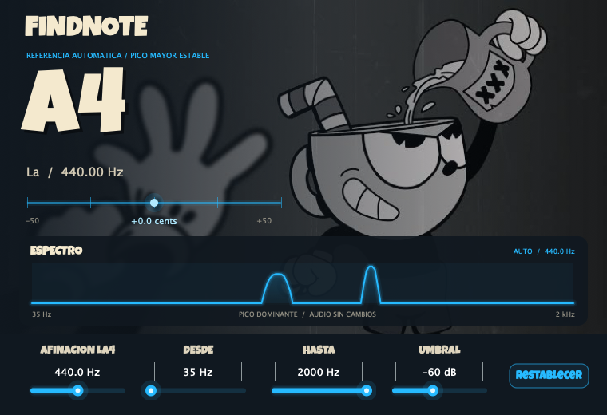

# FindNote

Plugin de audio que selecciona automáticamente el **pico dominante del espectro** y muestra su nota, frecuencia y desviación en cents. Arrástralo a una pista de audio; en una pista MIDI, colócalo después del instrumento. Reproduce el clip o activa la monitorización de entrada.

## Vista previa

Última vista previa del plugin, con el fondo de Cuphead, tipografía cartoon y controles azul neón:



### Fondo de Cuphead

FindNote conserva esta imagen como fondo. El archivo [assets/cuphead.jpeg](assets/cuphead.jpeg) se integra en el plugin al compilar; no necesitas tener la imagen en una carpeta externa para usarlo.


Ambas imágenes están incluidas en el proyecto y usan rutas relativas para que se vean también en GitHub.

## Formatos y plataformas

| Formato | macOS Apple Silicon | macOS Intel | Windows x64 |
| --- | --- | --- | --- |
| VST3 | Incluido | Incluido | Incluido |
| AU / Audio Units | Incluido | Incluido | No disponible en Windows |
| VST2 / VST | Opcional: requiere SDK VST2 | Opcional: requiere SDK VST2 | Opcional: requiere SDK VST2 |
| AAX / Pro Tools | Compilación experimental opcional | Compilación experimental opcional | Compilación experimental opcional |

Las compilaciones predeterminadas generan **VST3 + AU en macOS** y **VST3 en Windows**. VST2 y VST3 son formatos diferentes; cambiar la extensión no convierte uno en otro. El SDK VST2 no está incluido. JUCE contiene el SDK AAX en la revisión fijada, pero generar un `.aaxplugin` no lo habilita automáticamente para Pro Tools: la distribución requiere el proceso de firma de Avid/PACE. No se incluye firma PACE, certificado Developer ID, notarización de Apple ni firma Authenticode de Windows.

La compatibilidad dentro de Ableton y Pro Tools debe verificarse en esos hosts. Los paquetes de macOS se firman **ad hoc**. La ejecución nativa de Windows se valida en el runner Windows de Actions; no se presenta una compilación en macOS como prueba de Windows.

## Uso

La búsqueda empieza automáticamente entre **35 y 2000 Hz**. El marcador azul sigue el pico seleccionado: no hace falta colocar una referencia manual.

- **Afinación La4:** 440 Hz de fábrica, ajustable entre 400 y 480 Hz. Calibra la relación frecuencia/nota; no mueve el cursor de análisis.
- **Desde / Hasta:** límites opcionales para la búsqueda. Desde debe ser menor que Hasta.
- **Umbral:** ignora señales débiles; −60 dB por defecto.
- **Restablecer:** recupera los valores iniciales. También puedes escribir valores o restablecer un control con doble clic.

Si dos picos difieren menos de **1 dB**, el candidato debe ganar **tres análisis seguidos** para sustituir al anterior. Una ventaja clara o la desaparición del pico previo se aceptan en el análisis actual. El silencio, los cambios de rango o umbral y las discontinuidades reinician el seguimiento. Las frecuencias de notas diferentes no se promedian.

La nota corresponde al **pico dominante**, no necesariamente a la fundamental del instrumento. Con 110 Hz de fundamental y un tercer armónico dominante a 330 Hz, se muestra **Mi4 / E4**. Si domina el quinto a 550 Hz, se muestra **Do♯5 / C♯5**. No identifica acordes ni garantiza una nota útil en mezclas, percusión o ruido tonal. La convención de octavas es científica: **La4 = A4 = MIDI 69**.

El análisis usa una ventana Blackman-Harris, FFT e interpolación. Su ventana dura **171–186 ms** a las frecuencias de muestreo probadas y se actualiza cada **43–46 ms**, más el tiempo de procesamiento e interfaz. Confirmar un pico casi empatado puede añadir dos actualizaciones, **85–93 ms**. La salida de audio permanece idéntica a la entrada y el plugin declara **cero latencia de audio**. El cálculo se realiza fuera del hilo de audio.

## Compilar en macOS

Desde la raíz del proyecto, con Xcode, Python 3 y conexión a internet en la primera compilación. El wrapper instala CMake dentro de `.tools/venv` si no está disponible.

Apple Silicon, VST3 + AU:

```bash
bash scripts/build-macos.sh 1.0.0
```

Intel, VST3 + AU, con CMake disponible o la instalación local anterior:

```bash
python3 scripts/build.py --version 1.0.0 --arch x86_64 --build-dir build-macos-intel --package
```

Compilar Intel desde Apple Silicon requiere Rosetta para ejecutar las pruebas Intel. Actions usa un runner Intel nativo.

Para generar un ZIP local de Apple Silicon, desde la raíz y sin un paquete previo de esa versión en `dist/`:

```bash
bash scripts/prepare-release.sh 1.0.0
```

Los paquetes existentes se conservan. Puedes elegir otra carpeta mediante el script común:

```bash
python3 scripts/build.py --version 1.0.0 --arch arm64 --package --dist-dir dist/local
```

## Compilar en Windows

Desde la raíz del proyecto en **PowerShell**, con Python 3, CMake ≥ 3.22 y Visual Studio 2022 con **Desktop development with C++** y Windows SDK instalados:

```powershell
python scripts/build.py --version 1.0.0 --arch x86_64 --build-dir build-windows --package
```

El script configura Visual Studio x64, compila Release, ejecuta CTest, verifica la versión del manifiesto VST3 y genera el ZIP, SHA-256 y metadatos. No instala plugins en el sistema.

## VST2 y AAX opcionales

**VST2:** necesitas proporcionar un SDK antiguo obtenido legítimamente, con `pluginterfaces/vst2.x/aeffect.h` y `aeffectx.h`. No se descarga ni se redistribuye aquí. Consulta el [aviso oficial de Steinberg](https://helpcenter.steinberg.de/hc/en-us/articles/4409561018258-VST-2-Discontinued). Conserva tu SDK fuera del repositorio o dentro de `SDKs/`, que está ignorada.

Desde la raíz en macOS, reemplaza la ruta por la de tu SDK; añade VST2 a VST3 + AU:

```bash
python3 scripts/build.py --version 1.0.0 --arch arm64 --build-dir build-vst2 --vst2-sdk /ruta/al/VST2_SDK --package --dist-dir dist/vst2
```

Desde la raíz en PowerShell, con los requisitos de Windows y tu SDK:

```powershell
python scripts/build.py --version 1.0.0 --arch x86_64 --build-dir build-vst2 --vst2-sdk "C:\SDKs\VST2_SDK" --package --dist-dir dist/vst2
```

Si falta el SDK, la configuración falla con un mensaje explícito. Los runners públicos no lo tienen, por lo que VST2 no se anuncia como artifact predeterminado. Para una compilación CI con VST2 hace falta un runner con ese SDK y la variable de entorno `FINDNOTE_VST2_SDK_PATH`; la configuración actual usa runners hospedados sin ese SDK.

**AAX:** se puede habilitar con `--aax`, usando el SDK integrado en JUCE. Desde la raíz en macOS, para generar un paquete experimental independiente:

```bash
python3 scripts/build.py --version 1.0.0 --arch arm64 --build-dir build-aax --aax --package --dist-dir dist/aax
```

En Windows se usa el mismo script con `--arch x86_64`. En GitHub Actions puedes definir la variable de repositorio `FINDNOTE_BUILD_AAX=true` para incluirlo en las tres compilaciones. Esa opción **no realiza firma PACE**; consulta el [proceso de Avid para AAX](https://developer.avid.com/aax/). AU y AAX no son intercambiables.

## GitHub Actions y versiones

El workflow `.github/workflows/build-release.yml` se ejecuta en PR, push a `main` y ejecuciones manuales:

1. semantic-release calcula la versión en modo **dry-run**, sin crear tags ni releases. PR y ejecuciones manuales usan **0.0.0**.
2. Tres jobs compilan y prueban la misma versión y commit: `macos-15` (arm64), `macos-15-intel` (x86_64) y `windows-2022` (x64).
3. Cada job conserva durante 14 días un ZIP, un checksum y metadatos de la compilación.
4. Solo un push a `main` con cambios publicables llega al job de release, después de que pasen los tres builds. Antes de crear el tag, se verifican versión, commit, formatos y checksums de todos los paquetes.

Los archivos publicados son:

```text
FindNote-X.Y.Z-macOS-arm64.zip
FindNote-X.Y.Z-macOS-arm64.zip.sha256
FindNote-X.Y.Z-macOS-x86_64.zip
FindNote-X.Y.Z-macOS-x86_64.zip.sha256
FindNote-X.Y.Z-windows-x64.zip
FindNote-X.Y.Z-windows-x64.zip.sha256
```

Cada ZIP contiene carpetas por formato (`VST3/`, `AU/` cuando corresponda, y las opcionales `VST/` o `AAX/`) más los avisos de la fuente en `licenses/`.

| Commit | Incremento |
| --- | --- |
| `fix: corrige la detección` o `perf: reduce CPU` | Parche |
| `feat: añade un formato` | Menor |
| `feat!: cambia parámetros` o footer `BREAKING CHANGE:` | Mayor |
| `ci:`, `docs:` o `chore:` sin ruptura | Sin release |

La primera release publicable, sin tags anteriores, será **1.0.0**. No es obligatorio que el primer commit sea `feat:`: cualquier cambio reconocido como publicable puede iniciarla. En un squash importa el mensaje final que llega a `main`.

Node 24 y las dependencias están fijados mediante `.nvmrc` y `package-lock.json`. Se usa `npm ci --ignore-scripts`. El token automático `GITHUB_TOKEN` basta si las políticas del repositorio permiten crear tags/releases. Los jobs de planificación y publicación tienen `contents: write` porque semantic-release comprueba permiso de push incluso en dry-run; los jobs de compilación solo tienen lectura. No se publica en npm ni se hacen commits automáticos de versionado.

## Carpetas listas para subir

```text
.github/workflows/          CI y semantic-release multiplataforma
Source/                    Detector, procesador e interfaz JUCE
Tests/                     Pruebas DSP, integración y releases
assets/
  cuphead.jpeg             Fondo integrado
  fonts/                   Fuente, licencia y atribución
docs/
  images/findnote.png      Único preview vigente para el README
  UPLOAD_TREE.txt          Lista de archivos de fuente para subir
scripts/                   Compilación, paquetes y verificación de release
.gitignore
.nvmrc
CMakeLists.txt
package.json
package-lock.json
release.config.cjs
README.md
```

Sube estos archivos conservando las carpetas y los archivos ocultos `.github/`, `.gitignore` y `.nvmrc`. `.gitignore` excluye `build*/`, `dist/`, `.tools/`, `node_modules/`, `validation/`, SDKs locales, binarios, cachés y credenciales habituales. Los builds, paquetes y registros locales se conservan en disco. No se ha inicializado Git ni se ha ejecutado commit, push o publicación.

## Instalación

Descomprime el paquete de tu sistema y copia el plugin completo desde la carpeta del formato:

| Sistema / formato | Carpeta habitual |
| --- | --- |
| macOS VST3 | `~/Library/Audio/Plug-Ins/VST3/` |
| macOS AU | `~/Library/Audio/Plug-Ins/Components/` |
| macOS VST2 | `~/Library/Audio/Plug-Ins/VST/` |
| Windows VST3 | `C:\Program Files\Common Files\VST3\` |
| Windows VST2 | La carpeta VST2 configurada en tu host |

En Live 12, activa las fuentes de plugins correspondientes en **Settings → Plug-Ins**, pulsa **Rescan** y busca FindNote. AU solo funciona en macOS; AAX corresponde a Pro Tools. La instalación no se ejecuta como parte del build.

## Validación

Validación local del 12 de noviembre de 2026: **VST3 y AU compilados para arm64 y x86_64**, con ambas suites correctas en cada arquitectura (534 comprobaciones del detector). Las pruebas Intel se ejecutaron mediante Rosetta en este Mac. También se compiló **AAX arm64 experimental**, con ambas suites correctas. Se comprobaron versiones, checksums, contenido, licencias de la fuente y firmas ad hoc después de extraer los ZIP. Las **19 pruebas de release** y actionlint pasaron. El rechazo de VST2 sin SDK también se comprobó. **Windows y la publicación real en GitHub siguen pendientes de su primera ejecución en Actions; no se probaron Ableton ni Pro Tools.**

Los scripts nativos ejecutan CTest. Las pruebas incluyen 44.1, 48, 88.2, 96 y 192 kHz, tonos de 35 a 2000 Hz, armónicos dominantes 2.º/3.º/5.º, picos casi empatados, cambios claros, ruido, silencio, rango, calibración y audio sin cambios. El tiempo de ventana también se comprueba.

Desde la raíz, con Node ≥ 24.10 y npm, para validar las reglas y la integridad de las releases:

```bash
npm ci --ignore-scripts
npm run test:release
```

Para probar únicamente el detector, desde la raíz con CMake instalado:

```bash
cmake -S . -B build-core -DFINDNOTE_BUILD_PLUGIN=OFF -DCMAKE_BUILD_TYPE=Release
cmake --build build-core --config Release --parallel 3
ctest --test-dir build-core -C Release --output-on-failure
```

Los registros locales están en `validation/`, excluida del repositorio. Una compilación correcta y las pruebas sintéticas no sustituyen una prueba en Ableton o Pro Tools con instrumentos reales.

## Dependencias y recursos

JUCE 8.0.17-security está fijado al commit `dabd5ad13cd869cba41046947fffc8e5ce5cd662`. Su [licencia](https://github.com/juce-framework/JUCE/blob/dabd5ad13cd869cba41046947fffc8e5ce5cd662/LICENSE.md) ofrece AGPLv3 o licencia comercial; la licencia del código propio de FindNote sigue pendiente de elección y no se ha añadido un `LICENSE` que imponga una decisión al autor.

El fondo de Cuphead fue proporcionado por el usuario. Este repositorio no acredita una autorización de redistribución de esa imagen. La fuente **Luckiest Guy** de Astigmatic está disponible bajo Apache 2.0; sus archivos `LICENSE.txt` y `NOTICE.txt` se conservan en `assets/fonts/` y en los paquetes. La fuente está integrada una sola vez en el binario; no se copia un segundo TTF al bundle. No es la tipografía oficial de Cuphead.
